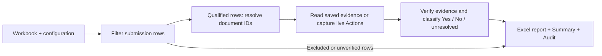

# xCCB Flawless Submission reporting

Python pipeline for loading the Forum Reviewers workbook, filtering submission rows, reading Actions through Windows Integrated Authentication, and producing an auditable Excel report. xCCB access uses GET requests; organization lookup uses read-only DataSyncX HR queries. No live records, report subscriptions, or deployments are modified.

## Setup and execution

Python 3.10+ on Windows, with access to the corporate network and xCCB under the account running the job:

```powershell
python -m venv .venv
.\.venv\Scripts\python -m pip install -r requirements.txt
.\.venv\Scripts\python -m pip install pytest
Copy-Item config.example.json config.json
```

Beautiful Soup handles HTML parsing and serialization with Python's built-in `html.parser`; openpyxl handles Excel. No browser runtime is required.

The selection rules are: Reviewing Forum contains `admin`; Reviewer(s) is blank or contains at least one listed reviewer name; and Phase does not contain `WLA` or `LSI modification`. Is FYI? does not restrict eligibility. The dashboard processes all available submission dates; use the Submitted column's Month or Day filter to select dates. CLI reports retain the current Malaysia month default. Reviewer matching uses substring containment, not exact identities or a required separator. Blank or whitespace-only Reviewer(s) cells qualify, including when the reviewer list is empty; nonblank cells still require a listed name. All other phases are accepted, including blank phase cells. Text comparisons ignore case and surrounding/repeated whitespace. All submission filtering, including optional organization selection, lives in `xccb_report/filtering.py`. All organizations are included by default. Eligibility completes before organization lookup, and only qualified managers are queried. Qualifying rows are grouped by Author Manager; missing managers are retained as `(Not specified)`.

One **listed names** list drives both checks: nonblank Reviewer(s) must contain a listed name, and any Action whose `Assigned By` exactly matches a listed name makes the row `No`. Names live in `reviewer_names` in the same per-user JSON settings file as the column filters. They override both name lists in config.json when present, including an explicitly empty list. An existing `reviewer_names.txt` is imported once only when JSON names are absent; subsequent saves and reloads use JSON, and no TXT file is created. Both checks normalize case and whitespace; commas are part of names. Duplicate editor lines are collapsed without changing the first spelling. `action_scope` remains `unconfirmed` until whole-document Actions history is approved. Submission/phase-specific scopes are not implemented. Legacy `reviewer_separator`, `manager_organizations`, `allowed_organizations`, and `phases` settings are ignored with a warning.

Run from the folder containing `config.json`. Supply the source workbook and a new output filename. Add `--live` to capture fresh Actions for each unique qualifying document in `outputs/evidence`; omit it to use previously captured evidence:

```powershell
.\.venv\Scripts\python -m xccb_report 'ForumReviewers (Includes Metadata).xlsx' outputs\Flawless_Submission.xlsx --live
```

There are no subcommands or configuration/output-path flags. `--live` is the only operational option; `--help` shows usage.

## Windows dashboard and executable

Double-click `dist/xCCB_Report.exe`. It includes Python 3.13, Tkinter, openpyxl, Beautiful Soup, timezone data, DataSyncX 1.1.6, pandas and the Oracle Python driver. No separate Python or DataSyncX installation is required on the target machine. Live access still requires Windows, corporate network access and an authorized account; organization lookup also requires the approved native Oracle Client and TNS configuration described below.

1. Enter the **Listed names** in the always-visible, scrollable column on the left (one name per line). The same list is used for the Reviewer(s) filter and the Actions `Assigned by` check.
2. Click **Upload** to select the Forum Reviewers `.xlsx` workbook. Optional source columns absent from the workbook are hidden, and their saved table filters are ignored.
3. Click **Process**. Summary cards and the **By Author Manager** tab update as each document finishes. The **Submissions** tab lists qualifying rows across all dates. Open the **Submitted** column filter and choose **Month** (`YYYY-MM`) or **Day** (`YYYY-MM-DD`), then check the dates to show. Double-click a row to open its xCCB workspace. Double-clicking a manager shows that manager's submissions.
4. Click **Export Excel…** to save the finalized report workbook for publishing or emailing.
5. Organization is looked up automatically for eligible managers across all organizations, using one bundled DataSyncX batch worker after filtering. Names must exactly equal the full HR `CCMAILNAME`, ignoring case and surrounding/repeated whitespace; nickname, partial-name and generated-name alternatives are not used. There are no name-confirmation dialogs. Multiple distinct employees with the same exact full name remain unresolved rather than choosing an arbitrary employee. The EXE does not ask you to select Python. There is no separate organization-selection button.

The dashboard generates the report in a temporary workbook and removes it after reading; a copy is written only when you use **Export Excel…**.

For qualifying submissions, **Document** shows the whitepaper filename from the workspace's `ViewOnlineDocument(...)` link between **Phase** and **Submitted** in the dashboard and Excel export, not the workbook's `CCB Title`. Live capture reads it from the already-fetched workspace page without opening the document file. The title is retained in hash-checked evidence for later offline reports. Missing or ambiguous file titles stay blank with an Audit note, rather than falling back to CCB Title. Older evidence must be refreshed live to populate Document.

In **Submissions**, click a column heading to open its inline value filter. Search the list, check the values to keep, then click **Apply**. Applied selections are saved by column name in JSON and restored on startup. Submitted supports Month and Day grouping; changing the grouping resets that column's value selection. Escape, Cancel or clicking outside dismisses unapplied value selections. Filters combine with the result filter and search. A filled dot marks filtered columns; **Clear filters** resets saved table filters. Table filters affect only the display, not summary counts or the exported report. Saved columns not available in a workbook are ignored.

If no submissions qualify, check the listed reviewers and business rules; an empty reviewer list accepts only blank Reviewer(s) cells. If qualifying rows are hidden, check the column filters or use Clear filters. Missing Actions settings or evidence leave qualifying rows visible with unresolved results rather than excluding them.

In Listed names, **Save list** saves names to JSON without processing. **Reload settings** reloads names and column selections after editing the JSON file. Names also load automatically on startup. Process saves the editor's names; unrelated settings are preserved.

The dashboard uses defaults without a config file. Optional `config.json` beside the executable (working directory in source mode) provides report defaults. Reviewer names, table selections, and organization settings share `%LOCALAPPDATA%\xCCB_Report\settings.json`; saving preferences does not change config.json. Existing input/output workbooks are never overwritten. Live captures replace evidence for the same document; use a separate evidence folder to retain a validated snapshot. The dashboard does not monitor Outlook or send email.

Run from source with `python dashboard.py`. Build with a separate Python 3.11-3.13 environment because DataSyncX 1.1.6 does not support Python 3.14 or newer. Use your approved package source for DataSyncX:

```powershell
py -3.13 -m venv .venv-build
.\.venv-build\Scripts\python -m pip install -r requirements-build.txt
.\build.ps1
```

The build checks the Python range and DataSyncX version before packaging. The verified build used the approved corporate DataSyncX Git repository `https://mfg-github.mfg.intel.com/intel-manufacturing/applications.manufacturing.analytics.atm.datasyncx`, revision `45fb2cecb677dc3c4f47ef58b8cc7ae68f280c0f`, because the configured corporate package index did not expose version 1.1.6. Building that revision requires `setuptools-scm` and the package-build-only environment variable `SETUPTOOLS_SCM_PRETEND_VERSION_FOR_DATASYNCX=1.1.6` to retain the release metadata. Obtain an approved artifact if your package index cannot supply the release; the build does not fall back to another project's environment.

The build writes `dist/xCCB_Report.exe` without a standalone reviewer TXT file. Rebuilding preserves per-user JSON settings. Close the running EXE before replacing it, or stage a build with `.\build.ps1 -DistPath dist\bundled`. PyInstaller's one-file windowed bundle extracts its runtime to a temporary directory when launched. DataSyncX's HR helper source and package metadata are included for the read-only adapter. Native Oracle Client, local `.env` files, user credentials, source workbooks, organization caches, captured evidence and user settings are not bundled.

## Private organization lookup and settings

Each Windows user owns independent files under their own `%LOCALAPPDATA%\xCCB_Report` (normally `C:\Users\<user>\AppData\Local\xCCB_Report`):

- `author_manager_organizations_exact.txt`: successful exact-full-name HR mappings only, UTF-8 TSV with a header. Standard CSV quoting applies with TAB as delimiter: fields containing tabs, newlines or quotes are double-quoted and embedded quotes doubled. Do not edit it as an unquoted split-on-tab format. The older `author_manager_organizations.txt` is left untouched for compatibility with older app versions; its alias/confirmed mappings are not trusted as exact matches. The first run rechecks eligible names and writes the new cache.
- `settings.json`: one file for `reviewer_names`, named `column_filters`, and organization settings. Filters use display headings such as `Phase` and `Submitted`; each contains `mode` (`value`, `month`, or `day`) and a `values` list. An empty list selects no values; `"all": true` makes the column unrestricted while retaining its date mode. `organization_python` is the optional source-mode approved Python path; the EXE uses its bundled worker. Older `organization_codes` are preserved but ignored by default reports. Unknown settings are preserved when saving.
- Adjacent `.lock` files coordinate writers. Do not delete these while any instance is running. Writes use unique temporary files, flush to disk, then atomically replace the destination. Cache updates reload and merge under the lock; a conflicting change to the same manager is reported instead of silently overwritten. Settings changes use last-writer-wins for the selected codes, preserving other settings keys.

The cache header, in order, is:

```text
display_name<TAB>lookup_name<TAB>wwid<TAB>organization_code<TAB>organization<TAB>looked_up_utc<TAB>identity_confirmed<TAB>matched_name
```

`<TAB>` above denotes an actual tab character. `display_name` retains the workbook spelling; `lookup_name` uses casefolding and collapsed whitespace. `wwid` and `organization_code` are strings. `looked_up_utc` is the last successful timezone-aware ISO timestamp. `identity_confirmed` is retained for format compatibility and is `no` for automatic matches. `matched_name` records the full HR name and must normalize to the requested name; only these verified exact-name entries are reused. The reader also accepts the older seven-column header, but requires revalidation before using those mappings in batch reports. No passwords, tokens or other credentials are written here or to settings. These are private local files, not a shared or distributed directory snapshot; do not copy them between users. Protect them as employee data using your normal Windows profile permissions and approved storage policy.

Successful exact-name mappings load on startup and are reused on later reports without queries. Missing normalized names are deduplicated across eligible rows and queried together. Rows excluded by the reviewer, date, forum or phase rules do not trigger directory queries; Audit labels these as not looked up rather than as lookup failures. Zero exact matches or multiple distinct matching WWIDs remain unresolved without prompting. To update an employee's organization, open the **Organization** column filter and choose **Refresh organizations**. This reruns the report and rechecks the exact full names of eligible managers only; other cached entries stay intact. A refresh with no unique exact match does not fall back to a previously selected identity. Edits must retain the exact header and all required fields. Malformed files cause an explicit error and are never silently replaced; repair them before continuing.

Directory work runs off the Tk UI thread in one batch subprocess after all eligibility decisions are complete. One Oracle query handles all requested names; multiple `IN` clauses within that query respect Oracle's 1,000-item list limit. Cache writes are serialized. The subprocess has a 45-second hard timeout. The EXE starts its own bundled worker, without external interpreter discovery or setup prompts. Source mode can offer one setup/retry prompt for the entire batch; a selected Python path is saved only after its query succeeds. Valid exact-name cached mappings remain usable after a runtime/access failure, with their successful lookup time and refresh failure visible in Audit. Unresolved managers are shown as `Unresolved`, and otherwise-qualified rows remain in the report. Reports with lookup issues remain DRAFT and show an organization warning in the dashboard status. **Force stop** prevents a batch that has not started; an in-flight batch may take up to 45 seconds to terminate.

Organization is adjacent to Author Manager in Submissions, By Author Manager, the main Excel sheet and Audit. Submissions' search and inline column filters include Organization and remain display-only; they do not initiate additional directory requests. CLI reports use the same per-user Python setting/cache, without setup or identity-confirmation dialogs; ambiguous names remain unresolved there.

The directory lookup searches eligible managers across all organizations, not an employee roster or an assumed KuAT subset. Organization descriptions come from each resolved identity; there are no AE/TE or whole-KuAT presets. Site KM and a KuAT substring are not membership rules; some KuAT employees are at PG. The app does not discover a full organization hierarchy, and current HR membership is not historical submission-time membership.

### DataSyncX Setup

The EXE already contains **DataSyncX 1.1.6** and its Python dependencies. Its packaged worker was verified with a read-only live HR lookup with external Python paths removed. The bundled runtime uses Python **3.13.14** and `oracledb` **3.4.2**; the local native Oracle Client used for that check was **11.2.0.4.0**. Authorized corporate HR access and the native Oracle prerequisites below are still required.

Only source-mode users need to install DataSyncX separately. This release declares Python `>=3.11,<3.14`; the report app itself still supports Python 3.10+ without live organization lookup. Use your organization's approved package repository/distribution and existing approved Oracle configuration. For example, with an approved Python 3.11-3.13 and the corporate package source already configured:

```powershell
python -m venv .datasyncx-venv
.\.datasyncx-venv\Scripts\python.exe -m pip install datasyncx==1.1.6
```

In the source dashboard, accept the **Organization lookup setup** prompt on a lookup failure and choose that environment's `Scripts\python.exe`. The manager lookup is retried immediately, and the path is remembered after success. Source mode initially uses its own interpreter, which may lack DataSyncX or use an unsupported Python release. The EXE never uses this prompt or saved interpreter path. No interpreter is installed or user-level Oracle configuration changed. The developer's migration-project path is not a runtime dependency. DataSyncX is installed by `requirements-build.txt`, not the source-only `requirements.txt`.

The adapter reads the installed `datasyncx.utils.get_user_email` helper's connection convention at runtime, then uses `datasyncx.utils.oracle_db.query_oracle` against `ALL.EMPLOYEE_HRDS / ATHRDS_WORKER`, excluding retired/terminated identities. No account values are copied into project code or user settings. Compatibility currently targets the inspected 1.1.6 helper; a changed helper convention needs revalidation.

The installed adapter calls `oracledb.init_oracle_client()` (thick mode). An approved, architecture-compatible native Oracle client, a working TNS resolution for `ALL.EMPLOYEE_HRDS`, corporate network/VPN and directory authorization are required separately. DataSyncX/pip installation alone does not supply these. Have IT provision them through approved procedures; this app does not install system clients or modify user-level Oracle/DataSyncX configuration. No Teams automation, Graph registration or another user's refresh is needed. If live access is unavailable, the user's own valid cache remains usable. A brand-new user without access/cache sees unresolved organizations and cannot reliably select them. Fresh-machine setup and complete KuAT hierarchy membership remain unverified.

Captures contain sanitized HTML and JSON manifests, without forms, hidden inputs, scripts, cookies, or authentication headers. Keep them inside approved storage. Up to four document workers overlap I/O; duplicate document references share one fetch per run. Live request starts share a throttle of at least one second between requests, with a 25-second HTTP timeout, a 35-second process timeout, and at most two attempts for transient failures. 401/403 are not retried. A 200 response without the expected iframe/panel is not a successful check. Capture failures and parser warnings appear in the report's Audit sheet. Completion order does not change the saved workbook's manager ordering.

Each output must have a new filename. Source and existing output workbooks are never overwritten. The report preserves source values, styles and hyperlinks, inserts `Organization` after `Author Manager`, puts the verified `Document` title after Phase, and appends `Flawless submission`. Column positions adapt to available optional source fields. Header row 3 becomes row 1. Summary and Audit record selection exceptions, evidence, matched identities and unresolved counts. Audit retains every input row outcome. The main sheet includes qualifying rows even when Actions classification is unresolved; missing settings or evidence produce a DRAFT without suppressing those rows.

CLI reports default to the current month in `Asia/Kuala_Lumpur`, using an inclusive first day and exclusive first day of the next month. The dashboard processes all dates and offers Month/Day filtering in Submitted instead of a separate month toolbar. Date selection does not change evidence freshness checks. Excel serials respect the source workbook's date epoch. Naive dates/times are local business values; aware timestamps use the business timezone.

## Completeness and classification

Capturing HTML does **not** mark evidence complete. Before a manifest is used, an authorized verifier must check the actual source and fill `scope: "document"`, `validated_by`, and `validation_notes`. Notes must identify the validation of full active/closed/historical listings, pagination, and scope. Set `complete: true` only when the whole relevant history was inspected. The application reparses the captured HTML, verifies its document ID/hash/time, and rejects stale, future, malformed, or mismatched evidence. The default maximum evidence age is 24 hours.

- One matching `Assigned By` identity gives `No` once the evidence scope is confirmed, even if the remaining listing is incomplete.
- No match gives `Yes` only when the full listing is attested complete and parsing has no warnings.
- Otherwise the Yes/No cell stays blank and Audit explains why.
- An empty listing additionally requires an explicitly observed empty-state message: set `empty_state_verified: true` and `empty_state_text` to that exact visible message. An absent/blank table is not sufficient.

Attestations are trusted local inputs, not cryptographic proof. Do not edit a manifest to force a result. A new live capture resets all attestations, so current `--live` reporting remains conservative until that capture has been validated. Automated live `Yes` classification is deliberately not enabled by an unproven global completeness assumption. A verified site-wide extraction contract could remove the per-capture review later; it has not been established in this investigation.

After verifying the manifests in `outputs/evidence`, rerun without `--live` and choose a new output filename to generate the report from that validated evidence.

Evidence is cached by Document ID only for explicitly whole-document scope, within the report run. Failed live capture never falls back to an older successful result. Phase/version/source date remain visible in Audit. Do not reuse this cache for submission-specific results.

## Process flow



`__main__.py` parses arguments and starts the report; `config.py` loads and validates `config.json`; `pipeline.py` coordinates eligibility, organization lookup and one capture per qualifying document; `workbook.py` reads the source and writes the formatted output workbook; `results.py` turns a generated report into dashboard rows; `gui.py` is the Tk dashboard only; `filtering.py` owns all submission selection and classification; `organizations.py` owns the HR directory cache and DataSyncX worker; `site.py` fetches and sanitizes HTML; `actions.py` extracts action identities; `evidence.py` creates and verifies manifests. All source rows appear in Audit.

## Validation and findings

```powershell
.\.venv\Scripts\python -m pytest -q
```

See [INVESTIGATION.md](INVESTIGATION.md) for live observations, three-document proof of concept, publishing options and remaining business decisions. Synthetic tests cover rule boundaries, parser failures, verified empty states, evidence integrity, duplicate references, workbook preservation and failed live refresh. UI comparison and the complete production workflow remain unverified.
