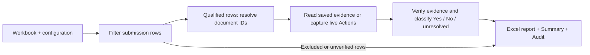

# xCCB Flawless Submission reporting

Python pipeline for loading the Forum Reviewers workbook, filtering submission rows, reading Actions through Windows Integrated Authentication, and producing an auditable Excel report. xCCB access uses GET requests; organization lookup uses read-only DataSyncX HR queries. No live records, report subscriptions, or deployments are modified.

## Setup and execution

Python 3.10+ on Windows, with access to the corporate network and xCCB under the account running the job:

```powershell
python -m venv .venv
.\.venv\Scripts\python -m pip install -r requirements.txt
.\.venv\Scripts\python -m pip install pytest
Copy-Item config.example.json config.json
```

Beautiful Soup handles HTML parsing and serialization with Python's built-in `html.parser`; openpyxl handles Excel. No browser runtime is required.

The selection rules are: Reviewing Forum contains `admin`; Is FYI? equals `No`; Phase does not contain `WLA` (case-insensitive); Document Submitted is in the reporting month (the current Malaysia month by default); and Reviewer(s) is blank or contains at least one exact name from the allowed reviewer list. Multiple reviewer identities in a source cell are separated by semicolons or newlines; commas are kept within names such as `Surname, Given name`. An empty allowed list accepts only blank Reviewer(s) cells. Every non-WLA phase is accepted, including blank phase cells. Text comparisons ignore case and surrounding/repeated whitespace. By default all organizations are included. An optional per-user report organization selection restricts eligibility to exact organization codes, consistently across dashboard totals and exports. Qualifying rows are grouped by Author Manager; source manager cells are preserved. Missing managers are retained as `(Not specified)` unless an organization selection requires their unresolved membership to be marked unverified.

One **listed names** list drives both checks from the requestor's guide: Reviewer(s) must contain a listed name, and any Action whose `Assigned By` is a listed name makes the row `No`. The list lives in `reviewer_names.txt` beside the executable (working directory for source/CLI runs), one name per line; when that TXT exists it overrides both `reviewer_names` and `assigned_by_names` in config.json. Without the TXT, the two config lists are used as before. Exact names match after case and whitespace normalization; commas are part of names. Blank lines in the TXT are ignored and duplicate names are collapsed without changing the first spelling. UTF-8, including a Notepad BOM, is supported. `action_scope` remains `unconfirmed` until whole-document Actions history is approved. Submission/phase-specific scopes are not implemented. Legacy `reviewer_separator`, `manager_organizations`, `allowed_organizations`, and `phases` settings are ignored with a warning. The phase rule is fixed to accept everything except values containing `WLA`.

Run from the folder containing `config.json`. Supply the source workbook and a new output filename. Add `--live` to capture fresh Actions for each unique qualifying document in `outputs/evidence`; omit it to use previously captured evidence:

```powershell
.\.venv\Scripts\python -m xccb_report 'ForumReviewers (Includes Metadata).xlsx' outputs\Flawless_Submission.xlsx --live
```

There are no subcommands or configuration/output-path flags. `--live` is the only operational option; `--help` shows usage.

## Windows dashboard and executable

Double-click `dist/xCCB_Report.exe`. It includes Python, Tkinter, openpyxl, Beautiful Soup and timezone data; no separate Python installation is required on the target machine. Live access still requires Windows, corporate network access and an authorized Windows account.

1. Enter the **Listed names** in the always-visible, scrollable column on the left (one name per line). The same list is used for the Reviewer(s) filter and the Actions `Assigned by` check.
2. Click **Workbook…** to select the Forum Reviewers `.xlsx` workbook. Select its reporting **Month** as `YYYY-MM` beside Refresh; it defaults to the current Malaysia month. Older workbooks require the corresponding earlier month.
3. Click **Refresh**. Summary cards and the **By Author Manager** tab update as each document finishes. When the run completes, the **Submissions** tab lists every qualifying row with its Flawless result, notes and original `Document WS URL`. Filter by result or search; double-click a row (or **Open link**) to open the xCCB workspace, or **Copy link**. Double-clicking a manager shows that manager's submissions.
4. Click **Export Excel…** to save the finalized report workbook for publishing or emailing.
5. Use **Organizations...** in the sidebar to select report organization codes, select the approved DataSyncX Python executable, or request a cache refresh on the next report. Press **Refresh** after changing the report selection. Ambiguous identities open an explicit confirmation dialog; leaving them unresolved never assigns an arbitrary person.

The dashboard generates the report in a temporary workbook and removes it after reading; a copy is written only when you use **Export Excel…**.

In **Submissions**, click any column heading to open its Excel-style value filter. Search the list, check the values to keep, then click **Apply**. Filters on multiple columns combine with the result filter and search. A filled dot marks filtered columns; **Clear filters** resets all table filters. These filters affect only the display, not summary counts or the exported report.

If no submissions qualify, the status names the selected month and shows the count with unverified eligibility. Check the reporting month and allowed reviewers; an empty reviewer list accepts only blank reviewer cells. Missing Actions settings or evidence leave qualifying rows visible with unresolved results rather than excluding them.

In the Listed names column, **Save list** saves names without refreshing. **Reload TXT** replaces the editor contents with the current file: use it after editing `reviewer_names.txt` in Notepad, then press **Refresh**. The list also loads automatically on startup. Keep the EXE and TXT together in a writable folder. Refreshing saves the reviewer list; unrelated configuration is preserved.

The dashboard uses defaults without a config file. If `config.json` exists beside the executable, it loads those settings; source mode loads it from the working directory. Reviewer edits persist to the existing TXT and organization settings persist separately per user; neither changes config.json. Existing input/output workbooks are never overwritten. Live captures replace evidence files for the same document and reset attestations; use a separate evidence folder to retain a previously validated snapshot. The dashboard does not monitor Outlook or send email.

Run from source with `python dashboard.py`. To reproduce the executable build:

```powershell
.\.venv\Scripts\python -m pip install -r requirements-build.txt
.\build.ps1
```

The build writes `dist/xCCB_Report.exe` and creates a blank `dist/reviewer_names.txt` only if that file does not already exist. Rebuilding preserves saved reviewer names. PyInstaller's one-file windowed bundle extracts its runtime to a temporary directory when launched. The credential-free organization worker script is bundled; DataSyncX, Oracle Client, credentials, source workbooks, organization caches, captured evidence and settings are not bundled.

## Private organization lookup and settings

Each Windows user owns independent files under their own `%LOCALAPPDATA%\xCCB_Report` (normally `C:\Users\<user>\AppData\Local\xCCB_Report`):

- `author_manager_organizations.txt`: successful HR mappings only, UTF-8 TSV with a header. Standard CSV quoting applies with TAB as delimiter: fields containing tabs, newlines or quotes are double-quoted and embedded quotes doubled. Do not edit it as an unquoted split-on-tab format.
- `settings.json`: `organization_codes` is a list of strings (empty means all organizations); `organization_python` is the optional path to the user's approved Python executable. Leading-zero codes such as `04643` must stay quoted strings. Unknown existing settings are preserved when saving.
- Adjacent `.lock` files coordinate writers. Do not delete these while any instance is running. Writes use unique temporary files, flush to disk, then atomically replace the destination. Cache updates reload and merge under the lock; a conflicting change to the same manager is reported instead of silently overwritten. Settings changes use last-writer-wins for the selected codes, preserving other settings keys.

The cache header, in order, is:

```text
display_name<TAB>lookup_name<TAB>wwid<TAB>organization_code<TAB>organization<TAB>looked_up_utc<TAB>identity_confirmed
```

`<TAB>` above denotes an actual tab character. `display_name` retains the workbook spelling; `lookup_name` uses casefolding and collapsed whitespace. `wwid` and `organization_code` are strings. `looked_up_utc` is the last successful timezone-aware ISO timestamp. `identity_confirmed` is `yes` after an explicit candidate choice, otherwise `no` for a single active name candidate. A single name match is not proof of the intended identity; Audit distinguishes these cases. No passwords, tokens or other credentials are written here or to settings. These are private local files, not a shared or distributed directory snapshot; do not copy them between users. Protect them as employee data using your normal Windows profile permissions and approved storage policy.

Successful mappings load on startup and are reused on later reports without queries. Missing normalized names are queried once per run across duplicate workbook rows. Multiple WWIDs require a choice showing WWID, name, site, organization code/description and cost center, or remain unresolved. Explicit choices persist; refresh uses their stable WWID, not another name guess. To update an employee's organization, check **Refresh cached organizations on next report** in Organizations and run Refresh. This refreshes mappings for managers in the selected workbook; other cached entries stay intact. To correct a mistaken name-to-identity confirmation, close all instances, back up your private TXT, remove that manager's record using a TSV-aware editor, then rerun and confirm the correct candidate. Edits must retain the exact header and all required fields. Malformed files cause an explicit error and are never silently replaced; repair them before continuing.

Directory work runs off the Tk UI thread. Each subprocess has a 45-second hard timeout; the first directory failure stops additional live requests for that run. Valid cached mappings remain usable after failure, with their successful lookup time and refresh failure visible in Audit. Unresolved managers are shown as `Unresolved`. With all organizations enabled, otherwise-qualified rows remain in the report; with an explicit selection, unresolved membership is `Unverified` and is retained in Audit, not counted as qualified. An excluded organization is also recorded in Audit. Reports with lookup issues remain DRAFT. **Force stop** prevents further organization lookups; an in-flight lookup may take up to 45 seconds to terminate.

Organization is adjacent to Author Manager in Submissions, By Author Manager, the main Excel sheet and Audit. Submissions' existing search and column filter include Organization and remain display-only. The sidebar report selection instead changes totals and exported rows; changing it disables export of the old report until Refresh. CLI reports use the same per-user settings/cache, without a confirmation dialog; ambiguous names remain unresolved there.

The picker lists exact codes from this user's successfully queried managers and retains saved selected codes. Additional exact codes can be entered, comma-separated. Use confirmed codes for the desired AE/TE units, including leading zeros. Verified examples are `63947` (KuAT ASSY/FINISH ENGINEERING), `64530` (KuAT Test Engineering), `04643` (KUAT AE CAM), and `70482` (KuAT); these are individual units, **not** complete AE/TE or whole-KuAT presets. Select an independently verified set of codes for a broader KuAT fallback. No automatic broad fallback is offered without that membership evidence. Site KM and a KuAT substring are not membership rules; some KuAT employees are at PG. The app does not discover a full organization hierarchy, and current HR membership is not historical submission-time membership.

### DataSyncX Setup

Live organization access requires a separate approved local Python with **DataSyncX 1.1.6**, its dependencies and authorized corporate HR access. This DataSyncX release declares Python `>=3.11,<3.14`; the read-only adapter was tested with Python **3.13.14**, `oracledb` **3.4.2**, and Oracle Client **11.2.0.4.0**. The report app itself still supports Python 3.10+ without live organization lookup.

Use your organization's approved package repository/distribution and existing approved Oracle configuration. For example, with an approved Python 3.11-3.13 and the corporate package source already configured:

```powershell
python -m venv .datasyncx-venv
.\.datasyncx-venv\Scripts\python.exe -m pip install datasyncx==1.1.6
```

In **Organizations... > DataSyncX Python...**, choose that environment's `Scripts\python.exe`, then Apply. Source mode defaults to its own interpreter; the EXE can discover `python.exe` on PATH if no path is selected. An explicit selection avoids accidentally using the wrong Python. The developer's migration-project path is not a runtime dependency. DataSyncX is intentionally not installed by `requirements.txt` or the executable build.

The adapter reads the installed `datasyncx.utils.get_user_email` helper's connection convention at runtime, then uses `datasyncx.utils.oracle_db.query_oracle` against `ALL.EMPLOYEE_HRDS / ATHRDS_WORKER`, excluding retired/terminated identities. No account values are copied into project code or user settings. Compatibility currently targets the inspected 1.1.6 helper; a changed helper convention needs revalidation.

The installed adapter calls `oracledb.init_oracle_client()` (thick mode). An approved, architecture-compatible native Oracle client, a working TNS resolution for `ALL.EMPLOYEE_HRDS`, corporate network/VPN and directory authorization are required separately. DataSyncX/pip installation alone does not supply these. Have IT provision them through approved procedures; this app does not install system clients or modify user-level Oracle/DataSyncX configuration. No Teams automation, Graph registration or another user's refresh is needed. If live access is unavailable, the user's own valid cache remains usable. A brand-new user without access/cache sees unresolved organizations and cannot reliably select them. Fresh-machine setup and complete KuAT hierarchy membership remain unverified.

Captures contain sanitized HTML and JSON manifests, without forms, hidden inputs, scripts, cookies, or authentication headers. Keep them inside approved storage. Up to four document workers overlap I/O; duplicate document references share one fetch per run. Live request starts share a throttle of at least one second between requests, with a 25-second HTTP timeout, a 35-second process timeout, and at most two attempts for transient failures. 401/403 are not retried. A 200 response without the expected iframe/panel is not a successful check. Capture failures and parser warnings appear in the report's Audit sheet. Completion order does not change the saved workbook's manager ordering.

Each output must have a new filename. The source and existing output workbooks are never overwritten. The report retains 43 source columns and their styles/hyperlinks, inserts `Organization` immediately after `Author Manager`, and adds `Flawless submission` as column AS (45 columns total). Header row 3 becomes row 1. Summary and Audit sheets record selection exceptions, evidence, matched identities, and unresolved counts. Audit retains all input row outcomes, original source row numbers, organization descriptions/codes, WWIDs, lookup timestamps and unresolved/confirmation decisions. The main sheet includes qualifying rows even when their Actions classification is unresolved. Missing Assigned By settings or unverified evidence produce a DRAFT with blank classification cells, without suppressing otherwise eligible rows.

The default reporting month is calculated at run time in `Asia/Kuala_Lumpur`; the dashboard can select another month explicitly. Both use an inclusive first day and exclusive first day of the following month. Selecting a historical month does not change the generation timestamp or evidence freshness checks, which still use the real current time. Excel serials respect the source workbook's date epoch. Naive dates/times are treated as local business values; aware timestamps are converted to the business timezone.

## Completeness and classification

Capturing HTML does **not** mark evidence complete. Before a manifest is used, an authorized verifier must check the actual source and fill `scope: "document"`, `validated_by`, and `validation_notes`. Notes must identify the validation of full active/closed/historical listings, pagination, and scope. Set `complete: true` only when the whole relevant history was inspected. The application reparses the captured HTML, verifies its document ID/hash/time, and rejects stale, future, malformed, or mismatched evidence. The default maximum evidence age is 24 hours.

- One matching `Assigned By` identity gives `No` once the evidence scope is confirmed, even if the remaining listing is incomplete.
- No match gives `Yes` only when the full listing is attested complete and parsing has no warnings.
- Otherwise the Yes/No cell stays blank and Audit explains why.
- An empty listing additionally requires an explicitly observed empty-state message: set `empty_state_verified: true` and `empty_state_text` to that exact visible message. An absent/blank table is not sufficient.

Attestations are trusted local inputs, not cryptographic proof. Do not edit a manifest to force a result. A new live capture resets all attestations, so current `--live` reporting remains conservative until that capture has been validated. Automated live `Yes` classification is deliberately not enabled by an unproven global completeness assumption. A verified site-wide extraction contract could remove the per-capture review later; it has not been established in this investigation.

After verifying the manifests in `outputs/evidence`, rerun without `--live` and choose a new output filename to generate the report from that validated evidence.

Evidence is cached by Document ID only for explicitly whole-document scope, within the report run. Failed live capture never falls back to an older successful result. Phase/version/source date remain visible in Audit. Do not reuse this cache for submission-specific results.

## Process flow



`__main__.py` parses arguments and starts the report; `workbook.py` loads and writes Excel and coordinates one capture per qualifying document; `rules.py` owns selection and classification; `site.py` fetches and sanitizes HTML; `actions.py` extracts action identities; `evidence.py` creates and verifies manifests. All source rows appear in Audit.

## Validation and findings

```powershell
.\.venv\Scripts\python -m pytest -q
```

See [INVESTIGATION.md](INVESTIGATION.md) for live observations, three-document proof of concept, publishing options and remaining business decisions. Synthetic tests cover rule boundaries, parser failures, verified empty states, evidence integrity, duplicate references, workbook preservation and failed live refresh. UI comparison and the complete production workflow remain unverified.
